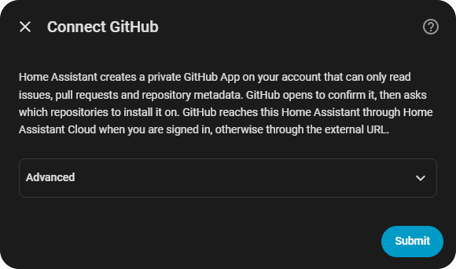
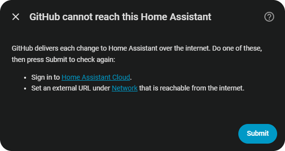

# GitHub Inbox for Home Assistant

Open issues, pull requests and GitHub Actions CI across your GitHub repositories, in a Home Assistant sidebar panel, with each comment and review collapsed to one line until you open it. GitHub pushes every change to Home Assistant through a webhook, so nothing polls. New activity and CI failures or recoveries can also notify your phone.

The integration creates a private GitHub App for your account from inside the config flow. GitHub hands the app's key and webhook secret to Home Assistant once; the setup asks for nothing to be typed.

## Screenshots



The first setup screen. Submit opens GitHub to create the app.



Without Home Assistant Cloud or an external URL, setup says what is missing and checks again on Submit.

## What you get

### The panel

GitHub Inbox in the sidebar, for administrators. Dark by default, with a light toggle.

| Part | What it shows |
|---|---|
| Tiles | Open issues, open pull requests (drafts counted apart), unseen items, items waiting on you, repositories, the oldest open item, and the last 7 days' activity with a sparkline. Click a tile to open its items: the first four filter the list (click again to clear), Repositories lists every item by repository, Oldest open opens that item, Activity goes to Recent activity. |
| By repository | Issues, pull requests and drafts per repository as stacked bars. Click a bar to filter the list to that repository. |
| Waiting on you | Items whose last word is someone else's, with the oldest listed. |
| Age of open items | Open items by age: a day, a week, a month, three months, a year, older. |
| Activity, last 14 days | Items opened, comments, reviews and closes per day. |
| The list | Every open item: title, number, repository, author, labels, age, the last word, `+additions −deletions` for pull requests and the comment count. Filter by kind, unseen or waiting; pick a repository; search; sort. |
| An open item | The description, then the timeline: every comment, review and line comment as one line (author, verb or review state, preview, time) that expands on click. Expand all, Collapse all, Open on GitHub. Opening an item marks it seen. |
| Recent activity | The newest 25 events across all repositories. |
| GitHub Actions CI | Failing, running and passing counts, then every installed repository with its latest default-branch run per workflow. |

An item is unseen when someone other than you has written on it since you last opened it. It is waiting on you when the last comment or review is someone else's. You are the logins in the Your GitHub logins option.

Bodies are GitHub's own rendering, sanitised: links open on GitHub, images and videos become links, and scripts, styles and frames are dropped.

### Entities

One service device per GitHub account.

| Entity | Type | What it is |
|---|---|---|
| Open issues | sensor | Open issues across the installed repositories. |
| Open pull requests | sensor | Open pull requests, drafts included. |
| Unseen | sensor | Items with activity from others since you last opened them. |
| Failing CI | sensor | Number of installed repositories with a failing latest workflow run; full repository names are an attribute. |
| Activity | event | Fires for every event: `opened`, `reopened`, `closed`, `merged`, `commented`, `reviewed`. Attributes: `repo`, `number`, `kind` (`issue` or `pr`), `title`, `url`, `actor`, `bot`, `own`, `state` (the review state). |
| Last delivery | sensor (diagnostic, disabled by default) | When GitHub last delivered a webhook. |

The entities are unavailable after a failed sync and while GitHub reports the app uninstalled or suspended.

### Notifications

New activity goes to the notify services you choose and, optionally, to a persistent notification. Events within 5 seconds of each other become one message ("3 updates in your repositories"). Each message is its own card in Home Assistant's notification list. On the Home Assistant Companion app a notification opens the panel and carries an Open on GitHub action. Your own and bot activity is left out unless you turn it on. CI failure and recovery notifications include the workflow run link regardless of who pushed; the CI notifications option is on by default.

### Actions

`github_inbox.resync` reads every open issue and pull request from GitHub again, for every account. It is an administrator action: a call from a non-administrator is refused; automations and scripts run it. It fails with the accounts GitHub could not be read for.

## Requirements

- Home Assistant 2026.3 or later.
- A route GitHub can reach: a Home Assistant Cloud subscription (the integration makes a cloudhook), or an external URL reachable from the internet (Settings, System, Network).
- A GitHub account, or an organization you own.

## Installation

[](https://my.home-assistant.io/redirect/hacs_repository/?owner=heidrickla&repository=ha-github-inbox&category=integration)

1. Press the button above, then Download in HACS, and restart Home Assistant when it asks.
2. Press this button to start the setup:

[](https://my.home-assistant.io/redirect/config_flow_start/?domain=github_inbox)

The setup asks for nothing to be typed:

1. Connect GitHub: press Submit. A window opens on GitHub showing the app it is about to create.
2. Press Create GitHub App on GitHub. The dialog moves on to the app's install page.
3. Install it on all repositories, or a selection. GitHub returns you to Home Assistant.
4. Notifications: your phones with the Home Assistant app are already ticked. Press Submit.

The Advanced section of the first screen holds the app's name, an organization to create it on instead of your account, and the webhook route; the defaults fit most setups. If GitHub cannot reach Home Assistant yet, the setup says so and links to Home Assistant Cloud and the network settings, and Submit checks again.

Without the buttons: HACS, the three-dot menu, Custom repositories, add `https://github.com/heidrickla/ha-github-inbox` as an Integration, download GitHub Inbox and restart; then Settings, Devices & services, Add integration, GitHub Inbox. Manual install: copy `custom_components/github_inbox` into your configuration's `custom_components` folder and restart.

From the Home Assistant app, the GitHub pages open in the phone's browser at another of Home Assistant's addresses: the Home Assistant Cloud address while the app uses the local one, the local address otherwise. On Android the create and install pages first open an `intent:` address that no app handles, so the browser keeps GitHub's pages and does not pass them to the GitHub app.

The first sync reads every open issue, pull request and repository's latest default-branch Actions runs; the panel fills as it completes.

A setup that is closed, or cut off by a restart, leaves no cloudhook behind: the integration records each cloudhook it makes and deletes those no entry or open setup uses, at startup and whenever a setup opens.

### Installation parameters

| Parameter | Meaning |
|---|---|
| App name | The GitHub App's name, up to 34 characters. GitHub App names are unique across GitHub; the default carries a random suffix. |
| Organization | An organization's login to create the app under it, for that organization's repositories. Blank for your personal account. |
| Webhook route | Home Assistant Cloud or the external URL. Only the routes available now are offered. |

The app is private, read-only (issues, pull requests, Actions and metadata), and subscribed to issues, issue comments, pull requests, reviews, review comments, repository and workflow run events.

### Configuration parameters

Settings, Devices & services, GitHub Inbox, Configure:

| Option | Default | Meaning |
|---|---|---|
| Notify services | none | The `notify` services to send to, such as `mobile_app_<phone>`. |
| Home Assistant notification | on | Also post to Home Assistant's notification list. |
| Notify on | new and reopened items, comments, reviews | Which events notify. Closed and merged is the fourth choice. |
| Include bots | off | Notify for activity by bots such as Dependabot. |
| Include my own activity | off | Notify for activity by your GitHub logins. |
| CI notifications | on | Notify when a repository starts failing CI or recovers to passing. |
| Your GitHub logins | the account | The logins counted as you for own activity, unseen and waiting. For an organization's inbox, add your personal login. |

Saving reloads the inbox with the new options.

### Reconfiguring

Reconfigure on the integration's menu moves the webhook between Home Assistant Cloud and the external URL, and points the GitHub App at the new address.

### Re-authenticating

Home Assistant asks for re-authentication when GitHub stops accepting the app's key or reports the app uninstalled or suspended. If the app still exists, the flow reinstalls it; if GitHub no longer accepts its key, it creates a new app on the same webhook. Reinstalling the app from GitHub's side is followed without a re-authentication: the installation's own webhook delivery names it.

### Removing it

1. Settings, Devices & services, GitHub Inbox, the three dots, Delete. This removes the cloudhook and the stored inbox.
2. On GitHub, open the app (the device page's Visit link, or Settings, Developer settings, GitHub Apps), then Advanced, Delete GitHub App.

## How it updates

GitHub delivers each change to the webhook as it happens. Each delivery is checked against the app's webhook secret before it is read, and applied at once; a few seconds later the item is read from GitHub for its rendered text and full timeline.

A full sync runs at setup, on the resync action and the panel's Sync now, after Home Assistant Cloud reconnects, and when repositories are added to the installation or renamed. It reads only the items that changed since the stored copy, plus the latest 50 default-branch Actions runs per repository, and notifies once for anything it found that no webhook delivered. A repository GitHub refuses to list, or a listing cut short, keeps its stored items until a later sync reads it in full. An unreadable Actions listing keeps that repository's stored CI. A failed sync retries after 5, 15 and then 60 minutes.

Activity on a closed issue or a merged pull request does not return it to the list. A renamed repository keeps its items, seen marks and activity under the new name.

## Examples

Flash the office light when a review asks for changes:

```yaml
triggers:
  - trigger: state
    entity_id: event.github_heidrickla_activity
conditions:
  - condition: template
    value_template: >-
      {{ trigger.to_state.attributes.event_type == 'reviewed'
         and trigger.to_state.attributes.state == 'changes_requested' }}
actions:
  - action: light.turn_on
    target:
      entity_id: light.office
    data:
      flash: short
```

Announce a new issue on one repository:

```yaml
triggers:
  - trigger: state
    entity_id: event.github_heidrickla_activity
conditions:
  - condition: template
    value_template: >-
      {{ trigger.to_state.attributes.event_type == 'opened'
         and trigger.to_state.attributes.kind == 'issue'
         and trigger.to_state.attributes.repo == 'heidrickla/ha-glkvm' }}
actions:
  - action: notify.mobile_app_phone
    data:
      title: New issue on ha-glkvm
      message: "{{ trigger.to_state.attributes.title }}"
```

A dashboard badge for unseen items: add `sensor.github_heidrickla_unseen` as a badge or tile.

## Use cases

- Issues and pull requests on your repositories are seen the day they arrive, without watching GitHub's notification page.
- A reviewer's request for changes reaches you where you are.
- Automations on repository activity, such as a light, a chime or a dashboard alert.

## Known limitations

- One entry covers one account or organization, with its own app. Add the integration again for another.
- The sync reads up to 1,000 open items per repository. Each item keeps its newest 200 comments, reviews and line comments.
- The activity log keeps 30 days, up to 500 events.
- GitHub does not redeliver a webhook Home Assistant missed; the sync after setup or a cloud reconnect recovers open items and new comments and reviews, and notifies them as one message.
- Images in comments are shown as links.

## Troubleshooting

| Symptom | Where to look |
|---|---|
| Nothing arrives | The app's page on GitHub, Advanced, Recent Deliveries, against the diagnostics' last delivery. Home Assistant answers 200 for a webhook no loaded entry has registered, so a 200 that leaves the last delivery unchanged means the entry is not loaded. 401 means the delivery was signed with a secret this entry does not hold, as when the app was recreated elsewhere. |
| A repair says GitHub cannot reach Home Assistant | The chosen route is down: sign in to Home Assistant Cloud, set an external URL, or Reconfigure to the other route. |
| The panel says Sync failed | Hover the chip for GitHub's answer. A rate limit or an outage clears on the next retry; Sync now retries at once. |
| A page says "Nothing is waiting" | The setup was closed or restarted. Start it again from Devices & services. |
| GitHub refuses the app name | Another app has it. Go back and choose another. |
| GitHub says it didn't find an App Manifest | The create page opened in a browser other than the one that sent the app's description. Start the setup again; if the phone asks which app opens GitHub, choose the browser the page opened in. From the Home Assistant app, Home Assistant needs a second address (Home Assistant Cloud or a local URL). |
| Last delivery is old | Enable the Last delivery sensor; compare it with GitHub's Recent Deliveries. |
| Actions permission needed | Follow the repair's GitHub App settings link, add Actions read under Repository permissions, tick Workflow run under Subscribe to events, and save. Then accept the new permission on the installation and Sync now. |

Diagnostics (the integration's three dots, Download diagnostics) carry the sync state and counts, with the key, the webhook secret, the webhook id and the notify services redacted, and no titles or bodies.

## Development

Tests run on Linux under Python 3.14 with `pytest-homeassistant-custom-component` 0.13.357 (Home Assistant 2026.8.3).

```bash
python -m pytest tests --cov=custom_components/github_inbox --cov-fail-under=95
```

```bash
python -m mypy custom_components/github_inbox
```

```bash
python tools/validate_local.py
```

`tools/make_brand.py` draws the brand images in `custom_components/github_inbox/brand/` and checks them against Home Assistant's rules.

| Module | Role |
|---|---|
| `api.py` | GitHub REST client: app JWTs, installation tokens, pagination. No Home Assistant imports. |
| `model.py` | Items and timelines from GitHub's JSON, the seen and waiting rules, the panel snapshot. No Home Assistant imports. |
| `sanitize.py` | Allowlist HTML sanitiser for GitHub's rendering. |
| `notes.py` | Notification text. |
| `coordinator.py` | The inbox: webhook events, the sync, notifications. |
| `webhook.py` | Signature check and delivery. |
| `config_flow.py`, `views.py` | App creation through GitHub's manifest flow, installation, reauth, reconfigure, options. |
| `websocket.py`, `frontend/` | The panel's commands and the panel. |

## Quality scale

The integration is built to the Integration Quality Scale's platinum rules; `custom_components/github_inbox/quality_scale.yaml` lists each rule with the reason for every exemption.

## Licence

MIT. See `LICENSE`.
